# LinkedIn Posts Manager — a multi-agent content strategist

A Claude Code multi-agent system that keeps a LinkedIn posting queue stocked with
**senior data engineering post ideas**. It reads the plan from Google Sheets, reads
every published post from LinkedIn, scores them for content quality, and lets three
independent LLM agents (Content Reviewer, Content Strategist, Editor) propose, critique
and revise the next 13 Saturdays of ideas. Nothing is written until the owner approves
the diff. A companion web app shows the queue, scores and coverage, and a 3D **Office**
replays each run with six android agents around one table.

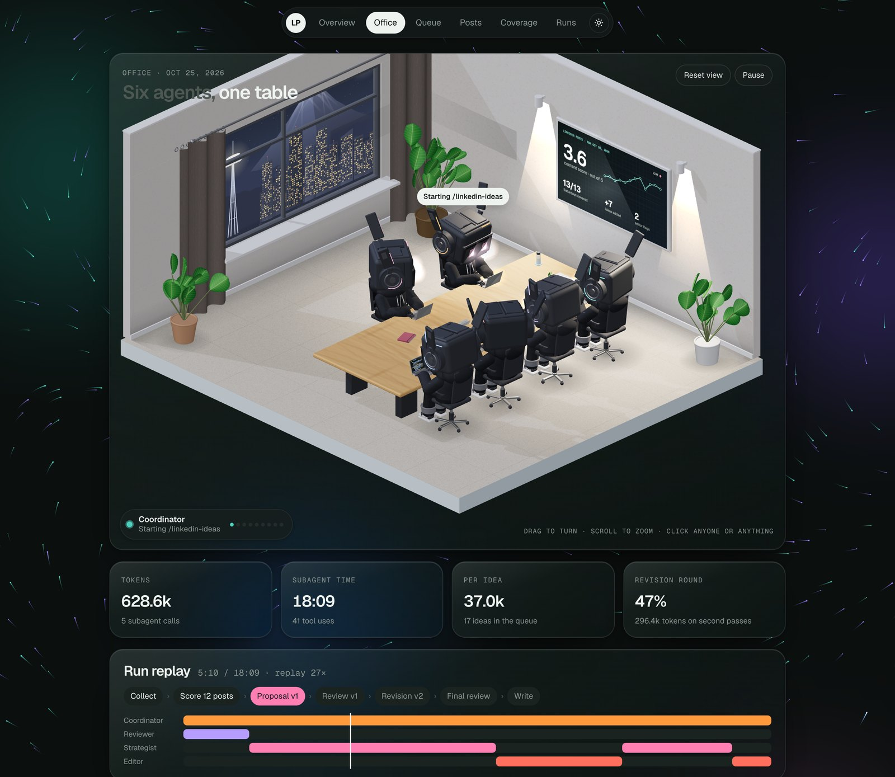


---

## Contents

- [What it does](#what-it-does)
- [Features](#features)
- [Architecture](#architecture)
- [The agents](#the-agents)
- [A run, step by step](#a-run-step-by-step)
- [Scoring and rules](#scoring-and-rules)
- [Results from the first run](#results-from-the-first-run)
- [The web app](#the-web-app)
- [The Office](#the-office)
- [Project layout](#project-layout)
- [Run it yourself](#run-it-yourself)
- [Security and privacy](#security-and-privacy)
- [Author & Certifications](#-author--certifications)

## What it does

The goal is to stay active on LinkedIn and show senior knowledge, **not** to chase reach.
So the system:

- **Proposes ideas only**: a pillar, a lens and a one-sentence topic per Saturday, plus a
  one-line *test* that would give the post real numbers. It never writes or publishes posts.
- **Scores content quality, not engagement.** Reactions and impressions are recorded but
  carry zero weight (`engagement_weight = 0`).
- **Keeps a rotation**: every pillar and lens gets used, nothing repeats too soon, and
  never-used topics catch up first.
- **Keeps a human in the loop**: every change is shown as a diff and written only after approval.

## Features

| Area | Feature |
|---|---|
| **Orchestration** | `/linkedin-ideas` Claude Code skill runs a 10-step pipeline with a task list, a `dry-run` mode and a per-run folder of JSON artifacts |
| **Collection** | Google Sheets connector for the plan; Claude in Chrome reads the full text of every published post, with lazy-load scrolling and chunked extraction |
| **Matching** | Decodes the publish date from the LinkedIn activity ID (first 41 bits are a ms timestamp) to link posts to schedule rows, with a topic fallback |
| **Three independent LLM agents** | Content Reviewer, Content Strategist and Editor each run in their own context, so the critic never shares the author's reasoning |
| **Revision loop** | Editor review → one Strategist revision → final Editor pass; ideas under 3.5 potential go back |
| **Hard-rule validator** | `validate_proposal.py` blocks touching posted/scheduled rows, double-booking Saturdays, rotation breaches and unknown pillar/lens names |
| **Novelty checks** | Every idea is compared with every row (any status) and the full text of published posts; same technique, different wording still counts as a duplicate |
| **Reproducibility** | Each idea carries a `test` field: what to run, on what data, measuring what |
| **Approval + write-back** | Diff table in chat; accept all, some or none. Exact writes are built offline (`build_writes.py`), sent, then read back and verified |
| **Run log** | `Post Scores` and `Agent Runs` tabs keep scores, change logs, Editor verdicts and per-agent token/time stats |
| **Web app** | Six tabs (Overview, Office, Queue, Posts, Coverage, Runs), light and dark themes, phone layout with a bottom bar |
| **Two hosts** | Google Apps Script (private) and Cloudflare Pages behind Cloudflare Access, installable to the iPhone home screen |
| **3D Office** | three.js room where six androids replay the run: hand-off packets, status chips, a live TV dashboard, night mode, clickable objects |

## Architecture

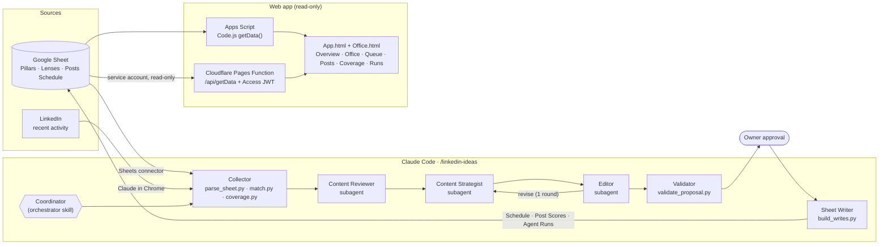

Config lives in one place: `config/strategy.toml` (IDs, horizon, rotation limits,
thresholds), `config/rules.md` (writing voice and banned patterns) and
`config/rubric.md` (scoring). Agents, scripts and the orchestrator all read the same files.

## The agents

The Office seats six roles. Three are LLM subagents; three are the orchestrator and its scripts.

| Seat | Kind | Job | Output |
|---|---|---|---|
| **Coordinator** | Claude Code session | Runs the skill, launches subagents, shows the diff, asks for approval | task list, approval view |
| **Collector** | scripts + connectors | Reads the sheet and LinkedIn, matches posts to rows, computes coverage | `sheet.json`, `posts.json`, `matches.json`, `coverage.json` |
| **Content Reviewer** | LLM subagent | Scores each published post 1-5 on five dimensions with a note each | `scores.json` |
| **Content Strategist** | LLM subagent | Proposes the queue: add, edit, drop or move, with a reason and a test for each | `proposal_v1.json`, `proposal_v2.json` |
| **Editor** | LLM subagent | Independent critic: duplicates, scope, feasibility, banned wording, potential score | `review_v1.json`, `review_v2.json` |
| **Sheet Writer** | scripts + connector | Builds exact writes, sends them, reads back and checks | `writes.json`, sheet rows |

Agent prompts live in [`.claude/agents/`](.claude/agents) and the orchestrator in
[`.claude/skills/linkedin-ideas/SKILL.md`](.claude/skills/linkedin-ideas/SKILL.md).

## A run, step by step

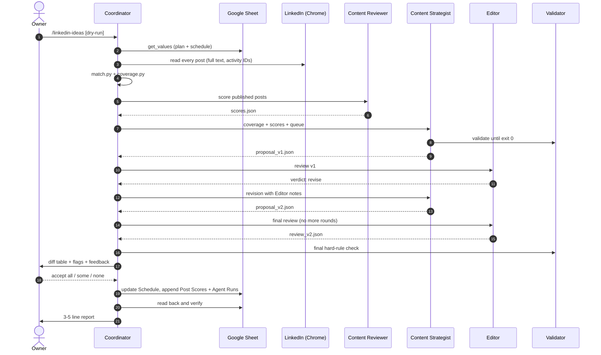

| Step | Who | Does |
|---|---|---|
| 0 Preflight | Coordinator | Load tools, check Chrome is signed in, create `runs/<run_id>/` |
| 1 Collect | Collector | Sheet → `sheet.json`; LinkedIn → `posts.json` |
| 2 Match | `match.py` | Activity-ID date decode, link posts to `Created & Posted` rows |
| 3 Score | Content Reviewer | Rubric scores per post → `scores.json` |
| 4 Strategize | Content Strategist | Proposal with add / edit / drop / move and a reason for each |
| 5 Review | Editor | Critique, one revision round, final pass |
| 6 Validate | `validate_proposal.py` | Hard rules; errors are shown, never hidden |
| 7 Approve | Owner | Diff in chat |
| 8 Write | Sheet Writer | One `update_spreadsheet` + value writes, then read-back |
| 9 Report | Coordinator | Changes, next three Saturdays, weakest dimension, sheet link |

## Scoring and rules

**Content rubric** (`config/rubric.md`) — each dimension 1-5:

| Dimension | A 5 looks like |
|---|---|
| Senior depth | A senior DE learns something past the first page of the docs: a failure mode, a limit, a non-obvious setting |
| Specificity | Concrete numbers, configs, tool and version names, a real outcome |
| Narrow scope | One decision, one bug, one setting, followed through |
| Credibility | Reproducible in a personal setup; numbers trace to a test; no employer material |
| Voice | Follows `rules.md`: problem-first, no hype, no emojis, no em dashes |

The Reviewer applies all five to published posts. The Editor applies the first four to
proposed ideas as a *potential* score: average ≥ 3.5 and no dimension below 3.

**Rotation** (`config/strategy.toml`):

| Rule | Value |
|---|---|
| Horizon | Next 13 Saturdays always covered |
| Pillar per 13-Saturday window | ≤ 2 |
| Same pillar back to back | Never |
| Same pillar + lens | Not within 12 weeks |
| Lens per 13-Saturday window | ≤ 2 |
| "X vs Y" framed topics | ≤ 1 in 4 |
| Topic length | ≤ 25 words, one sentence |
| Never-used pillars and lenses | Prioritized until they catch up |

Status lifecycle of a schedule row:

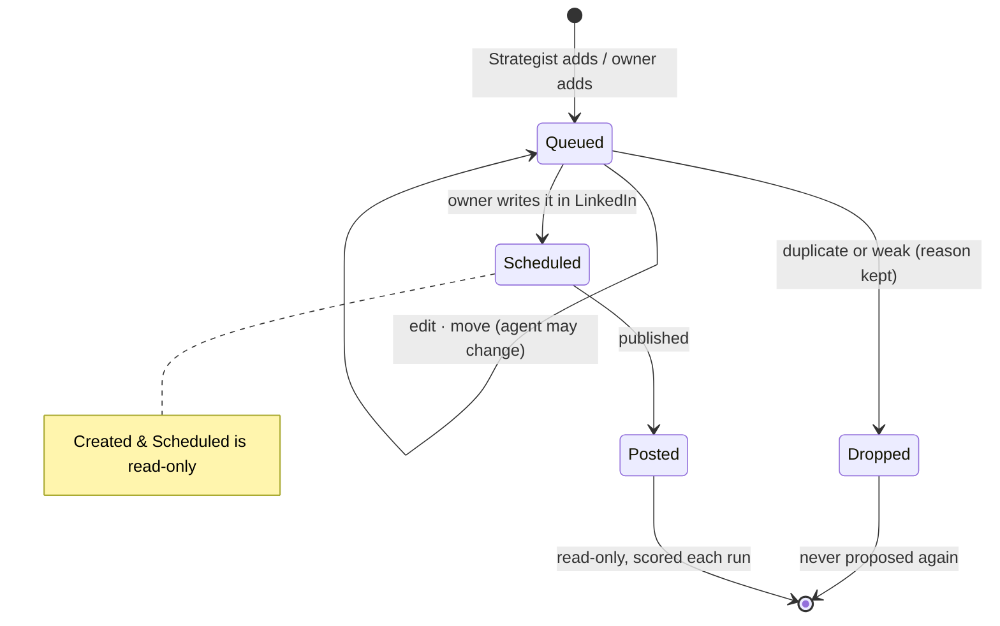

## Results from the first run

Run `r20261025-0927`, 12 published posts, 28 schedule rows, 13 pillars, 10 lenses.

### Content score of published posts — 3.6 / 5

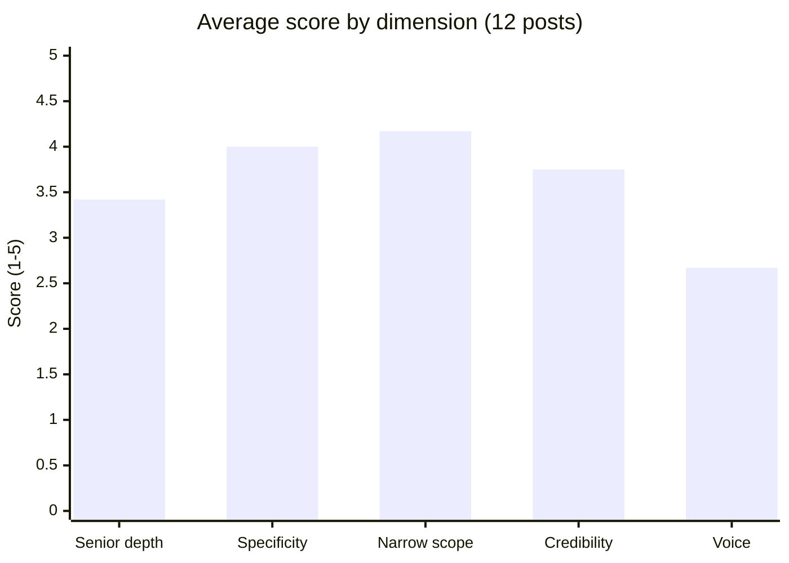

Best post 4.6, weakest 2.6. Narrow scope is the strength; Voice is the weakest
dimension, which is why the Strategist's feedback focuses on length and banned openers.

### Queue changes

| Added | Edited | Moved | Dropped | Rule errors |
|:-:|:-:|:-:|:-:|:-:|
| **7** | **10** | **9** | **4** | **0** |

### Coverage before → after

| | Before | After |
|---|:-:|:-:|
| Pillars never used | 5 of 13 | **0** of 13 |
| Lenses never used | 3 of 10 | **0** of 10 |
| Saturdays covered (next 13) | 13 | 13 |
| Most-used pillar (PySpark / Python) | 6 | 5 / 4 |
| Most-used lens (Performance) | 8 | 7 |

Data Lakehouse, CI/CD, Data Governance, NoSQL and Graph Models got their first ideas; so
did the Cost, Migration / Modernization and Business Translation lenses.

### Editor potential score, before and after revision

| Pass | Ideas reviewed | Average | Lowest | Below 3.5 |
|---|:-:|:-:|:-:|:-:|
| Review v1 | 16 | 4.11 | 3.5 | 0 |
| Final review | 17 | **4.27** | **3.8** | 0 |

### Agent usage

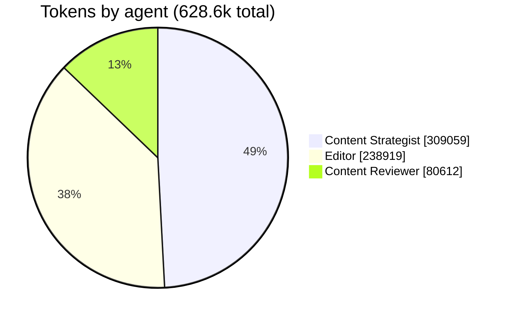

| Agent | Call | Tokens | Tool uses | Duration |
|---|---|--:|--:|--:|
| Content Reviewer | Score 12 posts | 80,612 | 6 | 2:02 |
| Content Strategist | Proposal v1 | 139,502 | 11 | 7:37 |
| Editor | Review v1 | 112,112 | 14 | 3:54 |
| Content Strategist | Revision v2 | 169,557 | 6 | 3:23 |
| Editor | Final review | 126,807 | 4 | 1:13 |
| **Total** | 5 subagent calls | **628,590** | **41** | **18:09** |

About 37k tokens per idea in the queue; the revision round (v2 + final review) is 47% of
all tokens, the price of having an independent critic.

## The web app

A read-only dashboard over the same sheet, served two ways: Google Apps Script (private
to the owner) and Cloudflare Pages behind Cloudflare Access (installable as a home-screen
app on iPhone). Both call one `getData()` that returns the same JSON.

**Overview** — next post, run status, content-score trend, next four Saturdays, Strategist
feedback, Editor flags and pillars not published yet.

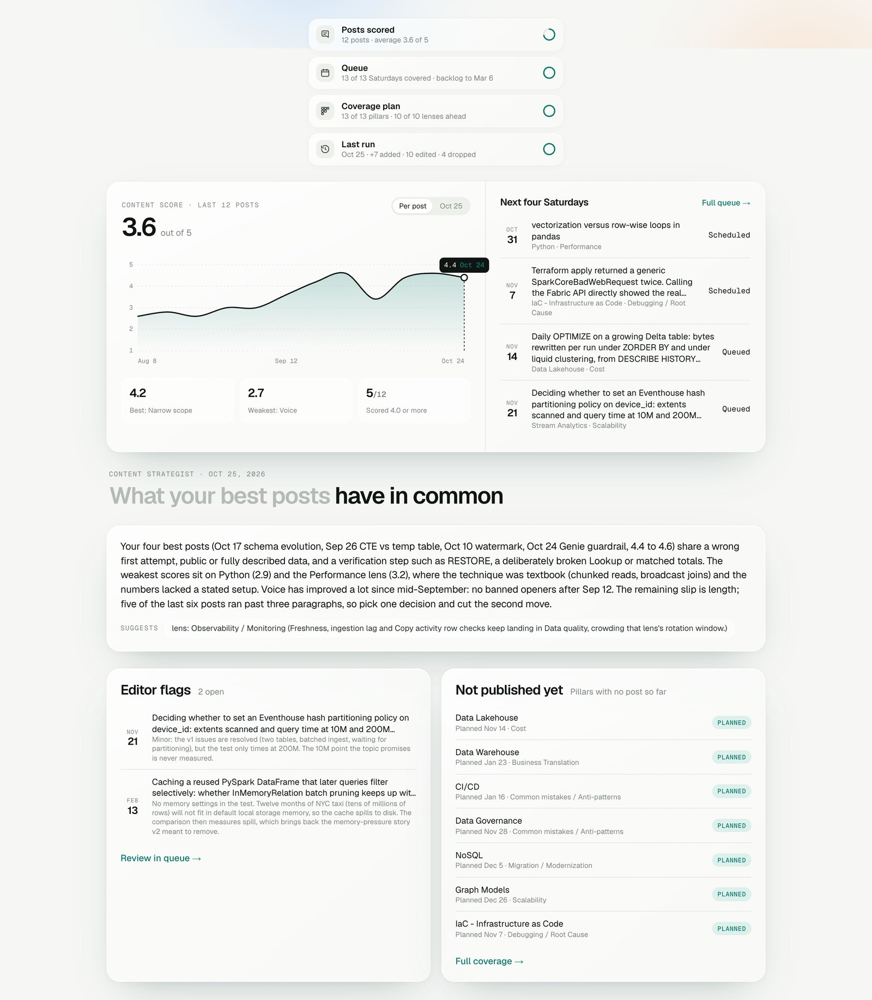

**Queue** — the next 13 Saturdays with pillar, lens, status, source (Me / Agent) and the
Editor's potential score. Expand an idea for its rationale and test.

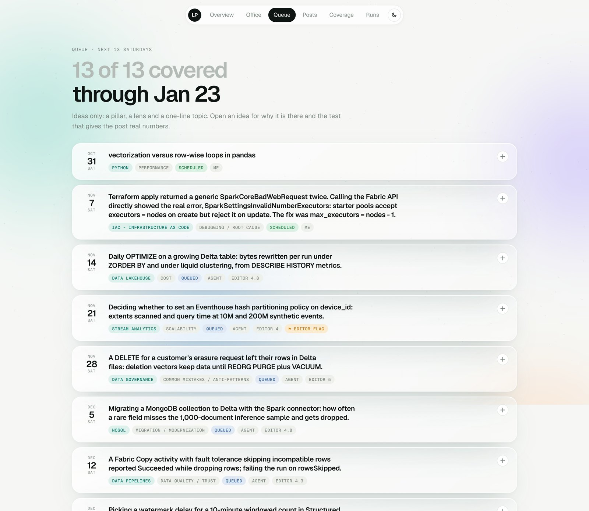

**Posts** — every published post with its content score and per-dimension notes.

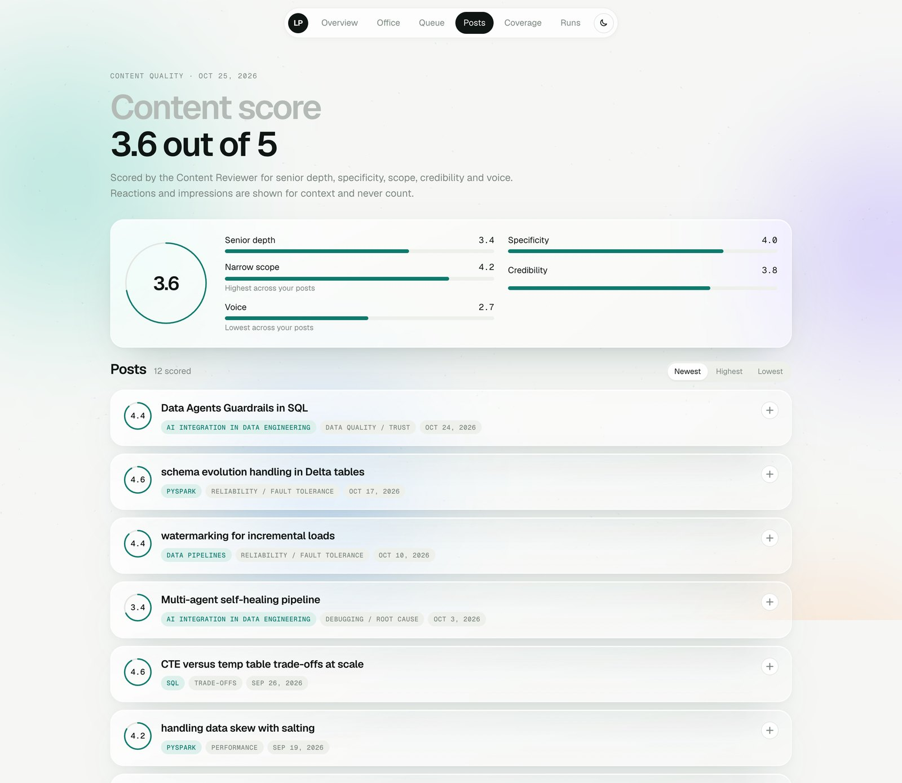

**Coverage** — pillar × lens heatmap of posted, scheduled and queued ideas, plus average
score by pillar and lens.

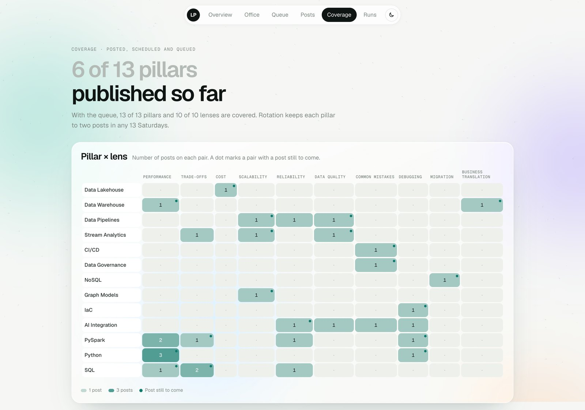

**Runs** — each agent run: summary, counts, Strategist feedback, coverage before → after
and the full change log.

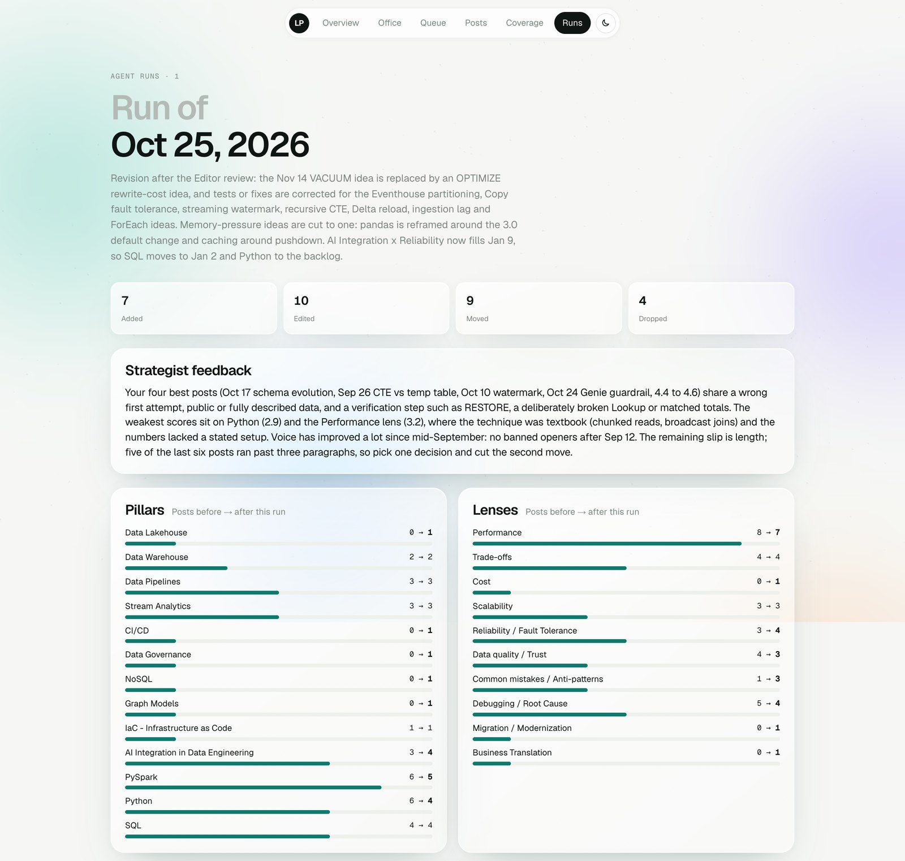

## The Office

A 3D tab (`webapp/Office.html`, three.js r147, loaded only when the tab opens) that turns a
run into something you can watch.

- An isometric cut-away room with six androids built in code: Coordinator and Content
  Strategist on the window side; Collector, Content Reviewer, Editor and Sheet Writer in front.
- The run plays on a loop: hand-off packets travel between laptops, a status chip floats
  over the active agent, and a wall TV shows the content score, Saturdays covered, ideas
  added and Editor flags.
- Every agent, the TV, window, notebook, phone, plants and table open a frosted info card.
- Drag to turn, scroll to zoom. Night mode lights up the city outside.
- Under the frame: run metrics (tokens, subagent time, tokens per idea, revision share) and
  a **run replay** timeline that shows which agent was working when, from the
  `Agent Stats` column of the `Agent Runs` tab.

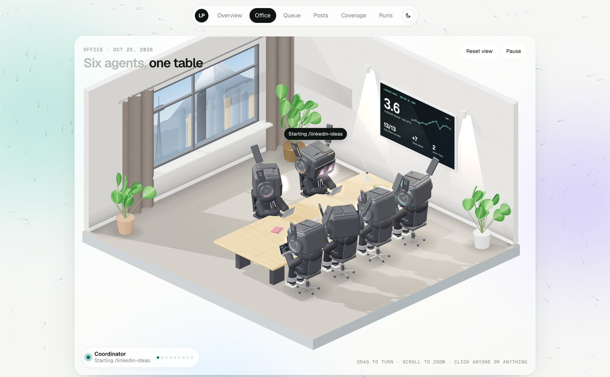

## Project layout

```
.claude/
  skills/linkedin-ideas/SKILL.md   orchestrator (steps 0-9)
  agents/content-reviewer.md       scores published posts
  agents/content-strategist.md     proposes the queue
  agents/editor.md                 independent reviewer
  launch.json                      local preview servers
config/
  strategy.toml                    sheet IDs, horizon, rotation limits, thresholds
  rules.md                         writing voice and banned patterns (single source)
  rubric.md                        scoring rubric
scripts/
  parse_sheet.py                   raw get_values -> sheet.json
  match.py                         activity-ID date decode + post/row matching
  coverage.py                      pillar/lens counts and gaps
  validate_proposal.py             hard-rule checks + diff.md
  build_writes.py                  exact sheet writes for an approved run (sends nothing)
  preview_webapp.py                builds the local preview / Cloudflare page
webapp/                            Apps Script project (clasp)
  Code.js                          getData() over the three tabs
  Index.html · App.html · Styles.html · Office.html
cloudflare/                        Cloudflare Pages host of the same app
  functions/api/[fn].js            /api/getData: Sheets API + Access JWT check
  public/                          icons and web manifest
runs/<run_id>/                     JSON artifacts per run (gitignored)
docs/images/                       README screenshots
PLAN.md                            design notes and decisions
```

## Run it yourself

The pipeline runs locally in Claude Code on your own machine. LinkedIn is read through
your signed-in Chrome, so it does not run in CI. Plan about an hour for the first setup.

### 1. Prerequisites

| Need | Why |
|---|---|
| [Claude Code](https://claude.com/claude-code) | Runs the `/linkedin-ideas` skill and the three subagents |
| Google Sheets connector in Claude Code | Reads and writes the sheet (`get_values`, `update_values`, `update_spreadsheet`, `get_spreadsheet`) |
| Claude in Chrome extension, signed in to LinkedIn | Reads the full text of your published posts |
| Python 3.11+ | Scripts use the standard library only (`tomllib`); nothing to `pip install` |
| A Google account | Hosts the sheet and, optionally, the Apps Script web app |
| *Optional:* Node 18+, [`clasp`](https://github.com/google/clasp), a Cloudflare account | Web app deploys |

### 2. Get the code

```bash
git clone https://github.com/felipecastro-data/linkedin-posts-manager-multi-agent.git
```

### 3. Build the Google Sheet

Create a spreadsheet with three tabs. The scripts find the tables by their **header text**,
so the names below must match exactly. Turn each range into a Sheets table
(*Format → Convert to table*); the writer grows the tables through their table IDs.

**Tab `LinkedIn Posts`**

| Table | Where | Content |
|---|---|---|
| Pillars | a cell reading `Pillars` above the schedule (e.g. B4), one pillar per row below it, no blank rows | Your content themes (e.g. PySpark, SQL, Data Lakehouse) |
| Lenses | a cell reading `Lenses` (e.g. D4), one lens per row below it | The angle a post takes (e.g. Performance, Cost, Trade-offs) |
| Posts Schedule | header row 21, columns B:I | `Date` · `Pillar` · `Lenses` · `Topic` · `Status` · `Rationale` · `Source` · `LinkedIn URL` |

- `Status` dropdown: `Created & Posted`, `Created & Scheduled`, `Not Created / In Queue`, `Dropped`.
- `Source` dropdown: `Me`, `Agent`.
- Add a row for each post already on LinkedIn with status `Created & Posted`. The agent
  only ever changes `Not Created / In Queue` rows.

**Tab `Post Scores`** — header in row 1, columns A:R:
`Run ID` · `Scored At` · `Post Date` · `Pillar` · `Lens` · `Topic` · `LinkedIn URL` ·
`Senior Depth` · `Specificity` · `Narrow Scope` · `Credibility` · `Voice` · `Score` · `Notes` ·
`Reactions` · `Comments` · `Reposts` · `Impressions`

**Tab `Agent Runs`** — header in row 1, columns A:M:
`Run ID` · `Run At` · `Summary` · `Strategist Feedback` · `Pillar / Lens Suggestions` ·
`Coverage Before` · `Coverage After` · `Added` · `Edited` · `Dropped` · `Moved` ·
`Change Log` · `Agent Stats`

### 4. Point the config at your sheet

Edit [`config/strategy.toml`](config/strategy.toml):

- `[sheet] spreadsheet_id`: the ID in your sheet's URL.
- `schedule_sheet_id`, `score_sheet_id`, `runs_sheet_id`: each tab's `gid` (in the URL when the tab is open).
- `schedule_table_id`, `score_table_id`, `runs_table_id`: ask Claude Code
  *"call get_spreadsheet on <id> and list each table's tableId"*.
- `schedule_header_row` if your schedule header is not on row 21.
- `[linkedin] profile_url` and `activity_url`: your profile.
- `[schedule]` and `[rotation]`: posting day, horizon and rotation limits to taste.

### 5. Make it yours

The prompts are written for one person. Replace these before the first run:

| File | Change |
|---|---|
| `.claude/skills/linkedin-ideas/SKILL.md` | Your name, your LinkedIn `recent-activity` URL, your time zone (`America/Bogota`) |
| `.claude/agents/*.md` | Your name (the owner the agents report to) |
| `config/rules.md` | **Your** writing voice, audience and banned patterns; the Reviewer scores against it |
| `config/rubric.md` | Scoring dimensions, if your audience is not senior data engineers |
| `scripts/match.py`, `webapp/Code.js`, `cloudflare/functions/api/[fn].js` | Time zone (`America/Bogota`) |

```bash
grep -rn "Felipe\|felipecastro-data\|America/Bogota" .claude config scripts webapp cloudflare/functions
```

### 6. First run

Open Claude Code in the repo folder, make sure Chrome is signed in to LinkedIn, then:

```text
/linkedin-ideas dry-run
```

A dry run does every step up to the approval view and writes nothing to the sheet. All
intermediate files land in `runs/<run_id>/` (gitignored), so you can inspect the scores,
proposal, Editor review and `diff.md`. When the proposals look right:

```text
/linkedin-ideas
```

It shows the diff and asks you to accept all, some (by date or row) or none before writing.
About once a month is enough to keep 13 Saturdays covered.

### 7. Optional: the web app on Apps Script

```bash
npm install -g @google/clasp
```

```bash
clasp login
```

`.clasp.json` points at the author's script. Create a blank project at
[script.google.com](https://script.google.com), copy its ID from *Project Settings → Script ID*,
put it in `.clasp.json` as `scriptId` (keep the other settings), and push:

```bash
clasp push -f
```

In the Apps Script editor: *Project Settings → Script properties* → add `SPREADSHEET_ID`
with your sheet ID, then *Deploy → New deployment → Web app*, **Execute as: Me**,
**Who has access: Only myself**.

To preview locally with data from a run, without deploying:

```bash
python3 scripts/preview_webapp.py runs/<run_id>
```

```bash
python3 -m http.server 8771 --directory webapp/preview
```

### 8. Optional: Cloudflare Pages (home-screen app on iPhone)

Apps Script serves pages inside a Google iframe, so iOS shows no app icon. The Cloudflare
host serves the same page with its own icon and manifest.

1. Create a Google Cloud **service account**, download its JSON key, and share the sheet
   with its email as **Viewer**.
2. Create a Cloudflare Pages project and a **Cloudflare Access** application on its domain
   (and `*.` preview subdomain) with a policy that allows only your email.
3. In [`cloudflare/wrangler.toml`](cloudflare/wrangler.toml) set `name`,
   `SPREADSHEET_ID`, `ACCESS_TEAM_DOMAIN` and `ACCESS_AUD` (the Access application's
   audience tag).
4. Add the key JSON as the `GOOGLE_SA_KEY` secret (Pages → Settings → Variables and Secrets,
   for Production and Preview), or from the CLI:

   ```bash
   cd cloudflare && npx wrangler pages secret put GOOGLE_SA_KEY
   ```

5. Deploy:

   ```bash
   cd cloudflare && npm install && npm run deploy:preview
   ```

   ```bash
   cd cloudflare && npm run deploy:prod
   ```

For local development with live data, create `cloudflare/.dev.vars` with
`DEV_NO_ACCESS=1` and `GOOGLE_SA_KEY=...` (gitignored), then `npm run dev` in `cloudflare/`.
A change to `getData()` in `webapp/Code.js` must be mirrored in
`cloudflare/functions/api/[fn].js`.

## Security and privacy

- The web app is **read-only**. Apps Script runs as the owner and is visible only to them;
  the Cloudflare site sits behind Cloudflare Access, and the function verifies the Access
  JWT itself so a misconfigured policy fails closed.
- The Cloudflare function reads with a read-only Sheets scope. Keys stay in Pages secrets
  and the gitignored `.dev.vars`.
- `runs/` (post text, scores, proposals) is gitignored.
- The agents never sign in, never write posts and never publish. Sheet writes happen only
  after explicit approval.

---

## 🏅 Author & Certifications

**Felipe Castro**
Senior Data Engineer @ EPAM Systems

- 🏅 **[DP-700: Microsoft Certified: Fabric Data Engineer Associate](https://learn.microsoft.com/api/credentials/share/en-us/FelipeCastro-8026/96572499DF943EBC?sharingId=13D660F56C1DFFA3)**
- 🏅 **[DP-600: Microsoft Certified: Fabric Analytics Engineer Associate](https://learn.microsoft.com/api/credentials/share/en-us/FelipeCastro-8026/6C5A2F5A8A5864FC?sharingId=13D660F56C1DFFA3)**
- 🏅 **[PL-300: Microsoft Certified: Power BI Data Analyst Associate](https://learn.microsoft.com/api/credentials/share/en-us/FelipeCastro-8026/F853AABE365874B3?sharingId=13D660F56C1DFFA3)**
